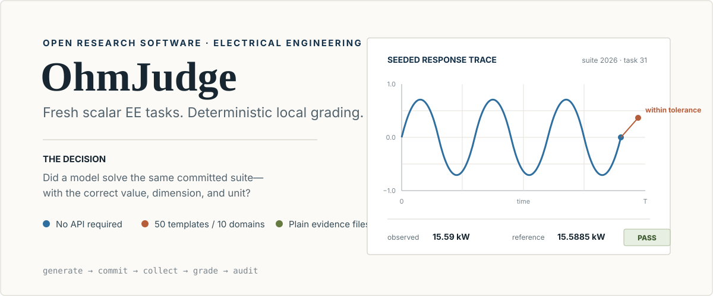
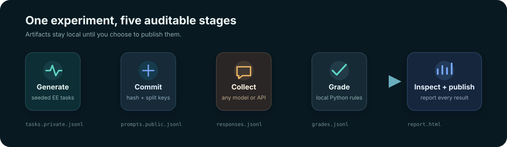

<div align="center">
  
</div>

OhmJudge generates fresh numerical electrical-engineering problems, gives the
same committed prompts to any model, and grades answers locally with executable
rules. Its default workflow needs **no API key**: use an answer-free offline
collector to copy prompts into a model's ordinary web interface, paste answers
back, and export the evidence for later grading.

[Answer-free collector](https://caoshurong.github.io/ohmjudge/demo/blind-collector.html)
· [Personal no-API lab](https://caoshurong.github.io/ohmjudge/demo/no-api-lab.html)
· [Synthetic report](https://caoshurong.github.io/ohmjudge/demo/report.html)
· [Methodology](docs/METHODOLOGY.md)
· [CI](https://github.com/CAOShurong/ohmjudge/actions/workflows/ci.yml)
· Python 3.11+ · MIT · zero runtime dependencies

> [!IMPORTANT]
> OhmJudge is an early research tool, not an authoritative model ranking. The included dashboard uses **clearly labelled synthetic responses** to demonstrate the reporting pipeline. It makes no claim about the named commercial models.

## Why this exists

Static benchmark questions can enter training data. LLM-as-a-judge scores can
also change when the judge model or judging prompt changes. OhmJudge addresses
a narrower, practical question: **can an individual researcher run a fresh,
same-suite EE calculation study without buying API access or trusting a hidden
judge?**

- **fresh tasks** — deterministic generators create a new suite from a recorded seed;
- **executable grading** — numeric answers, units, tolerances, and error categories are checked in Python;
- **model-agnostic use** — the answer-free collector works with any browser-based model;
- **auditable artifacts** — tasks, responses, grades, prices, and suite commitments are plain JSONL/JSON;
- **useful diagnostics** — see domain accuracy, confidence intervals, cost, latency, error types, and the price–accuracy Pareto frontier.

It currently includes 50 task templates across ten EE domains.

<div align="center">
  
</div>

## Install

Install the v0.3.0 wheel directly from the GitHub Release:

```bash
python -m pip install "https://github.com/CAOShurong/ohmjudge/releases/download/v0.3.0/ohmjudge-0.3.0-py3-none-any.whl"
ohmjudge doctor
```

Or install the exact tag from source:

```bash
python -m pip install "git+https://github.com/CAOShurong/ohmjudge.git@v0.3.0"
```

> [!NOTE]
> The package is not currently published on PyPI, so `pip install ohmjudge`
> alone is not advertised. Release wheels, source archives, and SHA-256
> checksums are attached to each GitHub Release.

For development:

```bash
git clone https://github.com/CAOShurong/ohmjudge.git
cd ohmjudge
python -m pip install -e .
```

## Run a no-API experiment

```bash

# Generate a private grading file plus a safe-to-share prompt file.
ohmjudge generate \
  --count 50 \
  --seed 2026 \
  --output tasks.private.jsonl \
  --public-output prompts.public.jsonl

# Build an answer-free, self-contained collector. It is safe to hand to the
# person collecting responses because it contains no reference answers,
# tolerances, or grading code.
ohmjudge collect \
  --tasks tasks.private.jsonl \
  --output blind-collector.html
```

In the collector:

1. record the web product, visible model label, date, settings, tools, and retry policy;
2. copy the current prompt into the model's normal web chat;
3. paste its answer back;
4. export a checkpoint and grade it later with the private task file.

Progress is saved in browser-local storage, and exported checkpoints can be
imported on another machine. Every response is bound to the exact suite
commitment. `audit` exits nonzero if responses from a different suite are
mixed in. Protocol fields are stored per model label, so two web products do
not silently inherit each other's settings.

For a quick personal practice run, `ohmjudge lab --tasks tasks.private.jsonl`
still provides live grading. That HTML embeds the private answer key and must
not be shared before a secrecy-sensitive collection is finished.

The model is instructed to return:

```json
{"answer": 12.34, "unit": "kHz"}
```

OhmJudge tolerates surrounding prose and a numeric fallback, but records the parse mode so a strict analysis can exclude fallback parsing.

## Build a shareable report

```bash
ohmjudge grade \
  --tasks tasks.private.jsonl \
  --responses responses.jsonl \
  --output grades.jsonl

ohmjudge report \
  --tasks tasks.private.jsonl \
  --grades grades.jsonl \
  --title "My frontier-model EE study" \
  --note "Web apps, zero-shot, collected 2026-08-04" \
  --output report.html
```

The report is a self-contained interactive HTML file—no server, CDN, tracker, or JavaScript dependency. It includes:

- model-level accuracy with Wilson 95% confidence intervals;
- a domain heatmap;
- error taxonomy;
- latency and token summaries when available;
- user-supplied price estimates and a log-scaled price–accuracy Pareto frontier;
- filterable per-task evidence.

Generate the bundled synthetic demo with:

```bash
ohmjudge demo --output demo
```

Or explore the [live project site and synthetic demo](https://caoshurong.github.io/ohmjudge/).

## Audit and compare experiments

```bash
ohmjudge audit \
  --tasks tasks.private.jsonl \
  --responses responses.jsonl \
  --grades grades.jsonl \
  --require-complete \
  --require-protocol \
  --output audit.json

ohmjudge compare \
  --grades grades.jsonl \
  --baseline-provider manual-web \
  --baseline-model "Model A" \
  --challenger-provider manual-web \
  --challenger-model "Model B" \
  --output comparison.json
```

`audit` recomputes every verdict and checks task coverage, capture-protocol
metadata, suite commitments, duplicates, units, tolerances, and cross-file
integrity. `compare` uses paired task outcomes and an exact two-sided McNemar
test; it warns when the discordant sample is too small for a strong conclusion. See
[Running an experiment](docs/EXPERIMENTS.md).

## What is tested

| Pack | Example templates | Deterministic checks |
|---|---|---|
| Circuits | voltage divider, RC cutoff, clipped op-amp, Thevenin resistance, series current | value, dimension, unit conversion, tolerance |
| Signals | RMS, Nyquist rate, alias frequency, sequence energy, convolution length | numeric or integer equality |
| Control | time constant, overshoot, settling time, pole radius, DC gain | formula-grounded numeric checks |
| Communications | Shannon capacity, free-space path loss, thermal noise, QPSK rate, link budget | logarithmic and linear-unit checks |
| Electronics | diode bias, BJT drive, MOSFET loss, ADC resolution, slew time | device-model and mixed-unit checks |
| Power | three-phase power, transformers, stored energy, PF correction, battery runtime | AC, energy, and efficiency checks |
| Electromagnetics | wavelength, plane waves, wire fields, capacitance, solenoids | physical constants and geometry checks |
| Digital | path delay, timing closure, counters, two's complement, Hamming distance | exact discrete and timing checks |
| Embedded | UART, PWM, timers, ADC buffers, I2C | firmware-facing timing and storage checks |
| Instrumentation | shunts, sensors, uncertainty, gain, Wheatstone bridges | measurement-chain checks |

The generators target calculation discipline and unit handling. They do **not** yet cover schematic images, open-ended design, HDL, RF layout, semiconductor process design, or safety certification. See [Methodology](docs/METHODOLOGY.md) for the exact validity boundary.

## Optional API runners

The browser workflow is the default. If you later want repeatable batch experiments, adapters are included for:

- OpenAI Responses;
- OpenAI-compatible Chat Completions, including providers that expose compatible endpoints;
- Anthropic Messages;
- replay from an existing response file.

API access is separate from a normal web subscription. OhmJudge never prints credential values. See [Provider setup](docs/PROVIDERS.md) before running a paid endpoint.

```bash
ohmjudge doctor
ohmjudge run \
  --tasks tasks.private.jsonl \
  --provider openai-responses \
  --model YOUR_MODEL_ID \
  --output responses.jsonl
```

## Reproducibility contract

Every generated task has:

- a stable ID derived from its content;
- a pack, template, and generation seed;
- a prompt and private expected value;
- an accepted unit and absolute/relative tolerance;
- generator parameters for audit.

`generate` also prints a SHA-256 suite commitment. Publish the commitment and
public prompts before collecting answers; the collector writes that commitment
into every response. Release the private task file after the evaluation window
if you want others to audit your result.

Read the [methodology](docs/METHODOLOGY.md), [experiment guide](docs/EXPERIMENTS.md), [data schemas](docs/SCHEMA.md), and [competitive landscape](docs/COMPETITIVE-LANDSCAPE.md) before reporting a serious comparison.

## Project map

```text
src/ohmjudge/
├── packs/          # seeded EE task generators
├── providers/      # optional remote runners
├── audit.py         # cross-artifact integrity verification
├── collector.py     # answer-free offline response collection
├── compare.py       # paired model comparison
├── generate.py     # suites and commitments
├── grade.py        # deterministic validator
├── lab.py          # no-API browser workflow
├── report.py       # standalone interactive report
└── stats.py        # confidence intervals and Pareto frontier
```

## Contributing

The most valuable contribution is a new task pack with an independently checkable answer—not a longer prompt. Start with [Writing a pack](docs/WRITING_A_PACK.md), then read [CONTRIBUTING.md](CONTRIBUTING.md).

Please cite the repository with the metadata in [CITATION.cff](CITATION.cff). OhmJudge is released under the [MIT License](LICENSE).

Planned verifier and task-family work is tracked in the [roadmap](ROADMAP.md).
